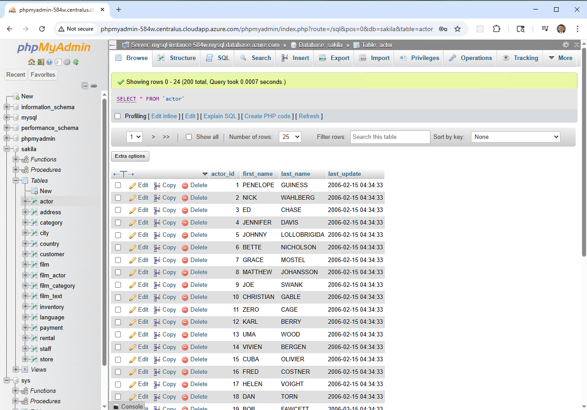
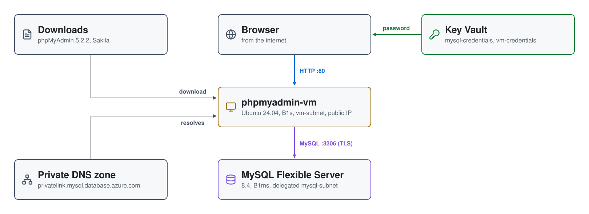

# MySQL on Azure: Azure Database for MySQL Flexible Server with phpMyAdmin

A private **Azure Database for MySQL Flexible Server**, built with Terraform
and loaded with the [Sakila](https://dev.mysql.com/doc/sakila/en/) sample
database. The server has no public endpoint; a **phpMyAdmin** VM with a public
IP gives you a browser client for it.



| Piece | Where | Role |
|---|---|---|
| **MySQL Flexible Server** | `mysql-subnet` (delegated) | `mysql-instance-<suffix>`, MySQL 8.4, `B_Standard_B1ms`, 32 GB, 7-day backups, zone 1; VNet-integrated, no public access |
| **Private DNS zone** | linked to `mysql-vnet` | `privatelink.mysql.database.azure.com`, so the server's name resolves to its private IP |
| **phpmyadmin-vm** | `vm-subnet`, public IP | Ubuntu 24.04, `Standard_B1s`; loads Sakila, then serves phpMyAdmin 5.2.2 |
| **Key Vault** | `mysql-rg` | `creds-kv-<suffix>`: `mysql-credentials` (database admin) and `vm-credentials` (VM login) |

## Architecture

<picture>
  <source media="(prefers-color-scheme: dark)" srcset="architecture-dark.svg">
  
</picture>

Regenerate with `python3 make_diagram.py`.

- **`01-mysql/`** is the whole stack: the resource group (`mysql-rg`), the
  VNet (`mysql-vnet`, 10.0.0.0/23) with the delegated `mysql-subnet`
  (10.0.0.0/25) and `vm-subnet` (10.0.1.0/25), the NSGs, the private DNS
  zone, the Flexible Server, the Key Vault and passwords, and the phpMyAdmin
  VM.

## How it boots

1. Terraform builds the network, the Key Vault, the Flexible Server and the
   VM, generating 24-character passwords for the `sysadmin` database admin
   and the `sysadmin` VM login.
2. The VM installs Apache, PHP and the MySQL client, downloads phpMyAdmin
   5.2.2, and points it at the server over TLS (`ssl = true`, certificate not
   verified). `/` redirects to `/phpmyadmin`.
3. It downloads Sakila from dev.mysql.com and loads the schema and data, then
   creates phpMyAdmin's own configuration tables in a `phpmyadmin` database.

## Network security

```
internet ─80, 22─▶ phpmyadmin-vm ─3306─▶ MySQL Flexible Server (delegated subnet)
```

| NSG | Subnet | Allows |
|---|---|---|
| `vm-nsg` | `vm-subnet` | 80 and 22 from anywhere |
| `mysql-nsg` | `mysql-subnet` | 3306 from anywhere |

The server is VNet-integrated with no public endpoint, so `mysql-nsg` only
matters inside the VNet.

## Prerequisites

* [An Azure Account](https://portal.azure.com/)
* [Install AZ CLI](https://learn.microsoft.com/en-us/cli/azure/install-azure-cli)
* [Install Terraform](https://developer.hashicorp.com/terraform/install)
* [Install jq](https://jqlang.github.io/jq/download/)

`check_env.sh` expects a service principal in `ARM_CLIENT_ID`,
`ARM_CLIENT_SECRET`, `ARM_SUBSCRIPTION_ID` and `ARM_TENANT_ID`. If this is
your first time watching our content, we recommend starting with this video:
[Azure + Terraform: Easy Setup](https://youtu.be/j4aRjgH5H8Q).

## Deploy

```bash
git clone https://github.com/mamonaco1973/azure-mysql.git
cd azure-mysql
./apply.sh       # one phase: VNet, Key Vault, Flexible Server, phpMyAdmin VM
```

Everything deploys to Central US. `apply.sh` ends by running `validate.sh`,
which waits for phpMyAdmin to answer (up to 15 minutes) and prints:

```
===============================================================================
BUILD VALIDATION RESULTS
===============================================================================
phpMyAdmin URL:
  http://phpmyadmin-a1b2.centralus.cloudapp.azure.com/

MySQL Flexible Server Endpoint:
  mysql-instance-a1b2.mysql.database.azure.com
===============================================================================
```

## Try it

1. Get the database password from Key Vault:

   ```bash
   vault=$(az keyvault list -g mysql-rg --query "[0].name" -o tsv)
   az keyvault secret show --vault-name "$vault" --name mysql-credentials \
     --query value -o tsv | jq -r .password
   ```

2. Open the phpMyAdmin URL and sign in as `sysadmin`. The `sakila` database
   is in the tree on the left.
3. Run the sample queries from the **SQL** tab:

   ```sql
   SELECT
       f.title AS film_title,
       CONCAT(a.first_name, ' ', a.last_name) AS actor_name
   FROM sakila.film f
   JOIN sakila.film_actor fa ON f.film_id = fa.film_id
   JOIN sakila.actor a ON fa.actor_id = a.actor_id
   ORDER BY f.title, actor_name
   LIMIT 20;
   ```

   ```sql
   SELECT
       f.title,
       GROUP_CONCAT(
           CONCAT(a.first_name, ' ', a.last_name)
           ORDER BY a.last_name
           SEPARATOR ', '
       ) AS actor_names
   FROM sakila.film f
   JOIN sakila.film_actor fa ON f.film_id = fa.film_id
   JOIN sakila.actor a ON fa.actor_id = a.actor_id
   GROUP BY f.title
   ORDER BY f.title
   LIMIT 10;
   ```

## Troubleshooting

| Symptom | Fix |
|---|---|
| `validate.sh` keeps retrying | The VM is still installing. SSH in as `sysadmin` (password in `vm-credentials`) and `sudo tail /var/log/cloud-init-output.log`. |
| `sakila` is missing | The load runs at the end of cloud-init; check the end of `/var/log/cloud-init-output.log` for `mysql` errors. |
| Sign-in fails | Use the password from `mysql-credentials`, not `vm-credentials`. |
| You want a local client | The server is private. Connect from the VM (`mysql -h <endpoint> -u sysadmin -p --ssl-mode=REQUIRED`). |

## Teardown

```bash
./destroy.sh     # destroys the whole stack, including the Key Vault
```

## Notes

- **Lab only.** phpMyAdmin is open to the internet over plain HTTP, SSH
  accepts password logins from anywhere, and the database password is in the
  VM's custom data. Restrict `vm-nsg` and add TLS for anything more.
